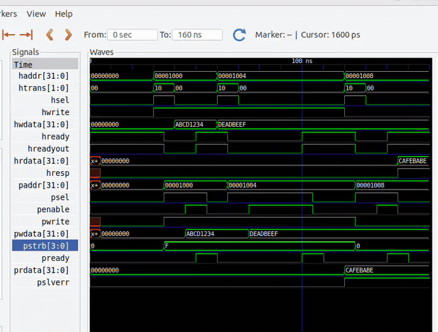
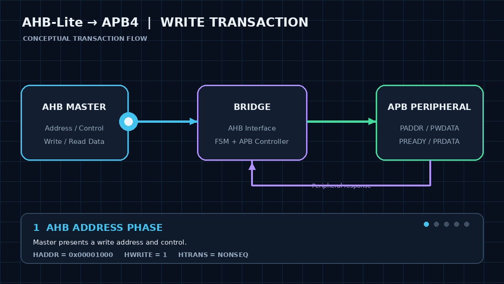
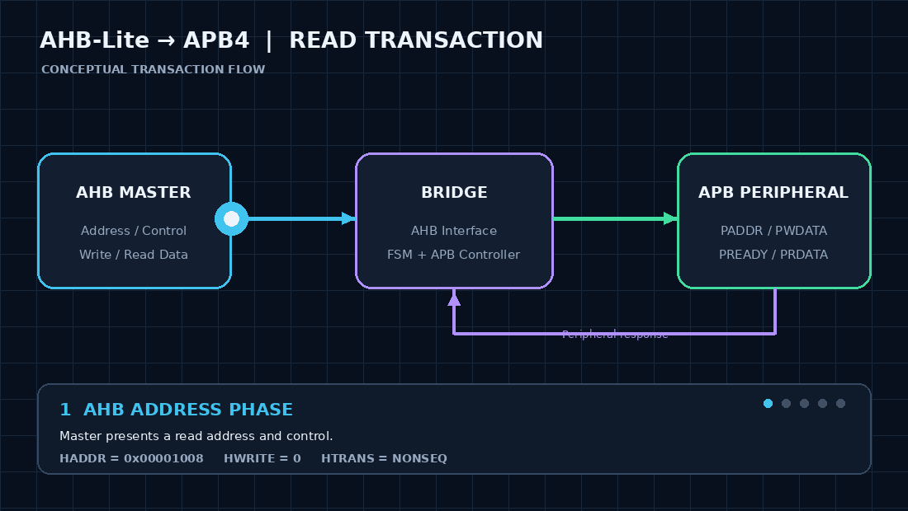

# AHB-Lite to APB4 Bridge

A modular **AHB-Lite to APB4 Bridge** implemented using SystemVerilog, enabling communication between high-performance AHB-Lite and low-power APB peripherals in a System-on-Chip (SoC).

**Key Focus:** RTL Design · Protocol Conversion · FSM Design · Simulation

## 2. Key Features

- **AHB-Lite Interface:** Address, control, and write-data capture.
- **APB4 Interface:** APB address, data, and control signal generation.
- **FSM-Based Control:** IDLE, SETUP, and ENABLE states.
- **Read/Write Transfers:** Basic single-transfer support.
- **Wait-State Handling:** Supports APB peripheral delays through PREADY.
- **Byte Strobe Generation:** PSTRB generation based on transfer size and address offset.
- **Error Handling:** APB error response propagation through PSLVERR and HRESP.
- **Modular RTL:** Separate interface, FSM, controller, and integration modules.

## 3. Simulation Demo




## 5. AHB Transaction Walkthrough

### 5.1 Write Transaction



### 5.2 Read Transaction



### APB State Machine

The bridge follows a three-state sequence to control APB transactions:

```text
       ┌──────────────────┐
       │       IDLE       │
       │   PSEL = 0       │
       │   PENABLE = 0    │
       └────────┬─────────┘
                │ Valid AHB transfer
                ▼
       ┌──────────────────┐
       │      SETUP       │
       │   PSEL = 1       │
       │   PENABLE = 0    │
       └────────┬─────────┘
                │ Next clock cycle
                ▼
       ┌──────────────────┐
   ┌───│      ENABLE      │◄───┐
   │   │   PSEL = 1       │    │
   │   │   PENABLE = 1    │    │
   │   └────────┬─────────┘    │
   │            │              │
   │        PREADY = 0 ────────┘
   │
   │        PREADY = 1
   │            ▼
   │     ┌──────────────┐
   └─────│     IDLE     │
         └──────────────┘
```

### Wait-State Handling

- The FSM remains in the ENABLE state while `PREADY = 0`.
- When `PREADY = 1`, the APB transfer completes.
- The FSM returns to IDLE after completion.

## 7. Address, Data and Control Signal Mapping

The bridge transfers address, data, and control information from the AHB-Lite interface to the APB4 interface.

| AHB-Lite Signal | APB4 Signal | Function |
|---|---|---|
| HADDR | PADDR | Peripheral address |
| HWDATA | PWDATA | Write data |
| HWRITE | PWRITE | Read/write control |
| HSIZE + HADDR[1:0] | PSTRB | Byte-lane selection for writes |
| HPROT | PPROT | Protection attributes |
| HRDATA | PRDATA | Read-data transfer |
| HRESP | PSLVERR | Error-response propagation |

### Byte Strobe Generation

`PSTRB` is generated using the AHB transfer size and address offset to select the byte lanes during write transactions.

For read transactions, `PSTRB` is deasserted.

## 8. AHB/APB Response Handling

The bridge handles APB completion and error responses and communicates the result back to the AHB master.

### Successful Transfers
- The APB transfer completes when `PREADY` is asserted during the ACCESS phase.
- Read data from `PRDATA` is captured and returned through `HRDATA`.
- `HRESP` indicates the transfer response.

### Wait-State Handling
- When `PREADY = 0`, the APB transfer remains in the ACCESS phase.
- `PSEL`, `PENABLE`, address, and control signals remain asserted or stable until the peripheral is ready.

### Error Handling
- `PSLVERR` indicates an error reported by the APB peripheral.
- The bridge propagates the peripheral error through `HRESP` to the AHB side.

## 9. Verification and Testing

The bridge was verified using a SystemVerilog testbench with directed read and write transactions.

### Test Scenarios

| Test Case | Description | Result |
|---|---|---|
| Write Transfer 1 | Write `0xABCD1234` to address `0x1000` | PASS |
| Write Transfer 2 | Write `0xDEADBEEF` to address `0x1004` | PASS |
| APB Wait States | Hold the transfer while `PREADY = 0` | PASS |
| Read Transfer | Read `0xCAFEBABE` from the APB peripheral | PASS |
| Error Response | Propagate `PSLVERR` to `HRESP` | PASS |
| APB Protocol Checks | Check signal stability during wait states and valid PSEL/PENABLE sequencing | PASS |

### Verification Environment

- **HDL:** SystemVerilog
- **Simulator:** Icarus Verilog
- **Waveform Viewer:** GTKWave
- **Testbench:** `ahb_apb_bridge_tb.sv`

The testbench uses directed stimulus and checks to validate basic bridge functionality and APB wait-state behavior.

## 10. Repository Structure

```text
ahb-apb-bridge/
│
├── rtl/
│   ├── ahb_interface.sv
│   ├── apb_controller.sv
│   ├── bridge_fsm.sv
│   ├── burst_controller.sv
│   └── ahb_apb_bridge.sv
│
├── tb/
│   ├── ahb_interface_tb.sv
│   ├── apb_controller_tb.sv
│   ├── bridge_fsm_tb.sv
│   └── ahb_apb_bridge_tb.sv
│
├── docs/
│   └── images/
│
├── sim/
│
├── .gitignore
└── README.md
## 11. Running the Simulation

### Prerequisites
- Icarus Verilog
- GTKWave (optional, for waveform viewing)

### Compile

Run the following command from the project root:

```bash
iverilog -g2012 -s ahb_apb_bridge_tb -o sim/bridge_tb_sim \
rtl/ahb_apb_bridge.sv \
rtl/ahb_interface.sv \
rtl/bridge_fsm.sv \
rtl/apb_controller.sv \
tb/ahb_apb_bridge_tb.sv

## 10. Repository Structure

```text
ahb-apb-bridge/
│
├── rtl/
│   ├── ahb_interface.sv
│   ├── apb_controller.sv
│   ├── bridge_fsm.sv
│   ├── burst_controller.sv
│   └── ahb_apb_bridge.sv
│
├── tb/
│   ├── ahb_interface_tb.sv
│   ├── apb_controller_tb.sv
│   ├── bridge_fsm_tb.sv
│   └── ahb_apb_bridge_tb.sv
│
├── docs/
│   └── images/
│
├── sim/
│
├── .gitignore
└── README.md
